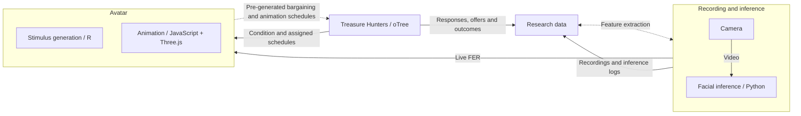

https://github.com/user-attachments/assets/8b6eb51b-cb1a-4744-9ecc-77d6b9c8062b

# Treasure Hunters
### A research platform for bargaining and controlled social interaction

A shipwreck is collapsing. A space station is about to explode. Two treasure hunters have found the same prize—and have **60 seconds to agree on how to divide it**.

**Treasure Hunters** combines an interactive bargaining experiment with animated 3D avatars, real-time computer vision inference, and face-to-face negotiation. It connects experimental manipulations with detailed behavioral records to study how emotions and conflict shape agreement. 

This repository contains the **oTree application** and serves as the main entry point to a platform developed across three connected projects: the bargaining game, the avatar behavior system, and the computer vision inference pipeline. The participant-facing part of the application is in **Spanish**.

## See it in action

### The bargaining game

#### Task

Players negotiate over a treasure pool by adjusting their demands on a slider in real time. They can make concessions or ask for larger shares while watching their opponent, the demands they make, and the time remaining. Matching proposals trigger a three-second agreement confirmation. If the deadline passes without agreement, both players receive zero from that round.

https://github.com/user-attachments/assets/8db4e58b-e9b8-4212-b84d-78f81ad0cfb7

#### Conflict and storyline

A walkthrough of the setup and storyline. A conflict of interest manipulation has participants lose their bags (treasure-carrying capacity) to an outside threat, forcing them to share part of the bounty. The total amount per round remains the same, only the distribution is constrained.

<table>
  <tr>
    <th>Conflict control</th>
    <th>Conflict treatment</th>
  </tr>
  <tr>
    <td width="50%">
      <video src="https://github.com/user-attachments/assets/313dc50a-f19c-46b2-a0b9-29eac485d66b" controls></video>
 </td>
    <td width="50%">
      <video src="https://github.com/user-attachments/assets/5c5ae587-1ec6-49c5-8c0f-a69f84ed6d5d" controls></video>
    </td>
  </tr>
</table>

### Avatar selection

We use Ready Player Me 3D avatars to give participants an immersive experience. They select an avatar for the game, which we animate for them using MediaPipe facial landmarking.

https://github.com/user-attachments/assets/35cf3de6-f45f-4432-ac78-0a6260c05edd

### Avatar phase and experimental smile-response

Participants are told they are playing with someone else from the session. In reality, the avatars follow a pre-scheduled stochastic bargaining policy. In a control condition, avatars show a pre-recorded baseline animation and initiate mild smiles at intervals. In an experimental condition, avatars are additionally designed to respond to participant smiles using real-time facial expression recognition (FER). Thus, both the bargain process and the social responses are exogenously controlled.

<table>
  <tr>
    <th>Smile control</th>
    <th>Smile treatment</th>
  </tr>
  <tr>
    <td width="50%">
      <video src="https://github.com/user-attachments/assets/c066b939-899b-4b8f-a042-0f68745a43d4" controls></video>
    </td>
    <td width="50%">
      <video src="https://github.com/user-attachments/assets/94bd7b00-e7e8-4536-824b-f387e946aa72" controls></video>
    </td>
  </tr>
</table>

*Note.* The participant view was added to these demonstration videos to illustrate how the avatar responds to the player’s facial expressions. This view is not shown to participants during the task. The smile control video also shows the restricted slider under the conflict manipulation, where participants have no bags and cannot carry the full treasure alone.

### Face-to-face phase

In a subsequent face-to-face phase, participants negotiate with each other in direct interaction, relaxing the previous experimental social constraints. Participants can see each other across their terminals, with the bargaining interface appearing at the upper edge of the screen. They receive occasional prompts to engage with (look at) the partner on the other side. 

The video shows the laboratory setting, with scientific-grade cameras (Basler pulse puA1280-54uc) recording participants' faces, lighting, and the computer terminals with the game interface. The video also demonstrates the progression of a face-to-face round. Participants are asked to remove the barrier on the table during round-start countdowns, and to place it back up after the round.

https://github.com/user-attachments/assets/3d1434de-ce12-46e7-a4ef-4c49d3465003

### Protocol

A session includes:

| Phase | Experience |
| --- | --- |
| Practice | One match introducing the interface and both conflict conditions. |
| Avatar negotiation | One match against a programmed avatar opponent, with assigned concession schedules and an experimental or control facial-response condition. |
| Face-to-face negotiation | Up to three matches with different partners, with automated room and seat assignments following a round-robin matchup procedure. |

Each match consists of two rounds against the same opponent. By the end of the session, a roulette randomly selects a payoff round for the whole group, following a random incentive system.

<table>
  <tr>
    <th>Practice instructions</th>
    <th>Payoff roulette</th>
  </tr>
  <tr>
    <td width="50%">
      <video src="https://github.com/user-attachments/assets/39bbebd0-7c96-428b-9338-7fc54ada7237" controls></video>
    </td>
    <td width="50%">
      <video src="https://github.com/user-attachments/assets/9a7c7c98-7ea3-4b5a-803c-c11609956420" controls></video>
    </td>
  </tr>
</table>


## One platform, three connected projects

The platform brings together experimental implementation, virtual opponent behavior and animation, and computer-vision pipeline.

| Project | Role | Main components |
| --- | --- | --- |
| **Treasure Hunters** — this repository | Experimental task and session coordination | Bargaining mechanics, participant interfaces, condition assignment, partner matching, questionnaires, payoffs, and event logs. |
| **[Avatar animation](https://github.com/nicolasgonzalezr/avatar-animation)** | Avatar behavior and the bridge between the experiment and facial inference | Statistical generation of concession schedules, preparation of background motion, facial-response dynamics, and browser rendering. |
| **[Face inference](https://github.com/nicolasgonzalezr/face-inference)** | Camera acquisition, live inference, recording, and post-processing | Camera control, integration of facial-expression and action-unit models, timestamped recordings and inference outputs, and offline processing. |

During avatar negotiation, FaceInferenceApp supplies live facial-expression estimates to AvatarAnimation, which uses them to animate the opponent within the oTree interface. The game supplies the condition and round metadata. In face-to-face rounds, the game also communicates directly with the acquisition service to identify the session, player, and round being recorded.



*Note.* Dashed arrows represent stimulus preparation and offline processing. Within the avatar system, R generates the stimulus schedules, while JavaScript and Three.js render the avatar and its responses to live facial estimates.

## This repository

| Path | Contents |
| --- | --- |
| `treasure_hunters/__init__.py` | Game logic, data models, live offer updates, page sequence, and custom event export. |
| `treasure_hunters/rounds.py` | Match scheduling, room and terminal assignments, treatment assignment, and condition sequences. |
| `treasure_hunters/scenes.py` | Story dialogue, scene definitions, and visual composition. |
| `treasure_hunters/*.html` | Participant interfaces, instructions, questionnaires, and payoff display. |
| `treasure_hunters/data/ConcessionSchedules.json` | Concession schedules generated in the avatar animation project and used by the game. |
| `_static/AvatarAnimation/` | Compiled browser animation bundles, face-tracking resources, and background motion data. |
| `_static/global/` | Story artwork and avatar thumbnails. |
| `requirements.txt` | Pinned dependencies for the oTree application. |

## Running the platform

The oTree application was developed with **Python 3.11.13** and **oTree 5.10.4**. The avatar components use JavaScript, Three.js, and MediaPipe face tracking. Large assets are managed with Git LFS.

To reproduce the full laboratory workflow, configure the three components together:

1. **Prepare the oTree application.** Configure OTREE_SECRET_KEY, OTREE_ADMIN_PASSWORD, and OTREE_REST_KEY as persistent environment variables on the server. The admin report will requests the REST key at the beginning of the session.
2. **Supply the avatar models.** The public repository excludes .glb files because of their size. You may supply compatible avatar models or request the original files by email. The interface expects _static/global/avatars/NeutralAvatar.glb and matching blue/red avatar variants under _static/global/avatars/glb/.
3. **Configure the face inference app.** Set up the cameras and inference models, then start the local service on each participant terminal at localhost:8001/ws. See the FaceInferenceApp repository for camera and processing configuration.
4. **Use the AvatarAnimation runtime.** Compiled browser bundles are included here. Make changes to animation behavior or stimulus generation in the AvatarAnimation repository, then copy the updated bundles and generated assets into the oTree application.
5. **Prepare the browser.** Avatar components require camera access and support for WebGL and OffscreenCanvas.

Retrieve the available Git LFS assets after cloning:

```bash
git lfs install
git lfs pull
```

Once the local components are configured, install the oTree dependencies and start its development server from the project root:

```bash
python -m pip install -r requirements.txt
otree devserver
```

The round duration, treasure value, carrying constraints, and offer-step settings are defined in `class C` in `treasure_hunters/__init__.py`. Avatar behavior and inference settings are maintained in their respective companion projects.

## Contact

For questions about the platform and its implementation:

Nicolás González-Raposo — nicgonzalezr@udd.cl · [ORCID](https://orcid.org/0000-0002-2723-0354)
